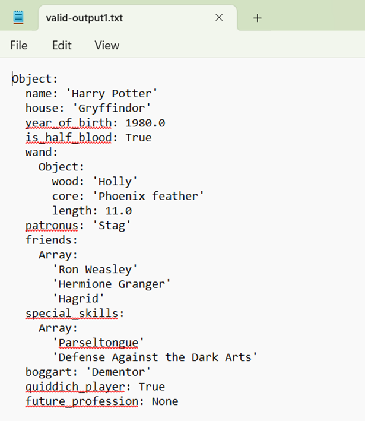

# A JSON Compiler (Frontend)

A **recursive-descent parser** in Python for the frontend of a basic JSON compiler. It
reads a JSON token stream from a `.txt` file, checks it for syntax and semantic errors,
and writes either an **Abstract Syntax Tree (AST)** or an error message to an output file.

See [Documentation.docx](Documentation.docx) for the full grammar and design.

## Features

- Recursive-descent parsing of the JSON grammar:
  ```
  value : dict | list | STRING | NUMBER | "true" | "false" | "null"
  list  : "[" value ("," value)* "]"
  dict  : "{" pair ("," pair)* "}"
  pair  : STRING ":" value
  ```
- Semantic checks, each reported as a numbered error:

  | Type | Error | Rule |
  |---|---|---|
  | 1 | Invalid Decimal Numbers | digits required on both sides of the decimal point |
  | 2 | Empty Key | dictionary keys can't be empty or whitespace |
  | 3 | Invalid Numbers | no leading zeros (except `0.x`) and no leading `+` |
  | 4 | Reserved Words as Dictionary Key | `true` and `false` can't be keys |
  | 5 | No Duplicate Keys in Dictionary | keys must be unique within a dictionary |
  | 6 | Consistent Types for List Elements | all list elements must have the same type |

- A separate lexer, [`Scanner.py`](Scanner.py), that turns a JSON string into a token stream

## Requirements

Python 3.6 or newer. No third-party packages.

## Usage

### 1. Prepare a token stream

The parser reads one token per line in the form `<TYPE, value>`, ending with an `EOF`
token. For example, the start of [`Test Inputs/valid-input1.txt`](Test%20Inputs/valid-input1.txt):

```
<LPAREN, None>
<STRING, name>
<COLON, None>
<STRING, Harry Potter>
<COMMA, None>
...
<EOF, None>
```

Token types: `LPAREN` (`{`), `RPAREN` (`}`), `LBRACKET` (`[`), `RBRACKET` (`]`), `COLON`,
`COMMA`, `STRING`, `NUMBER`, `TRUE`, `FALSE`, `NULL`, `EOF`.

You can write token files by hand, or generate the tokens for a JSON string with the
scanner and save its output to a `.txt` file:

```
$ python Scanner.py
Please enter a valid JSON string: {"a": [1, 2.5], "b": null}
<LPAREN, None>
<STRING, a>
<COLON, None>
<LBRACKET, None>
<NUMBER, 1.0>
...
<EOF, None>
```

The scanner converts numbers to floats (`1` becomes `1.0`), so the number-format checks
(types 1 and 3) only apply when the token file keeps the original number text, as the
files in `Test Inputs/` do.

### 2. Run the parser

```
$ python Parser.py
Please enter the information below, and enter input file as 'done' to quit:
Please enter input file name: Test Inputs/valid-input1.txt
Please enter output file name: output1.txt
Please enter input file name: done
```

File names are relative to the directory you run the parser from. The output file
contains the AST for a valid input, for example:



or a single error message such as `Error type 1 at 16.: Invalid Decimal Numbers.`

## Testing

[`Test Inputs/`](Test%20Inputs) has three valid inputs and one input per error type;
[`Test Outputs/`](Test%20Outputs) has the expected result for each:

| Input | Expected output |
|---|---|
| `valid-input1.txt` – `valid-input3.txt` | `valid-output1.txt` – `valid-output3.txt` |
| `errorFile-type1.txt` – `errorFile-type6.txt` | `output-error1.txt` – `output-error6.txt` |

Run each input through the parser as shown above and compare the output file with the
matching expected file.

## Project structure

```
├── Scanner.py           # lexer: JSON string -> token stream
├── Parser.py            # recursive-descent parser + semantic checks -> AST
├── Documentation.docx   # grammar, error types, and design write-up
├── Test Inputs/         # token-stream test files
├── Test Outputs/        # expected parser output for each test file
└── valid-output1.png    # example AST output
```

## Author

Nafisah Nubah (nafisahnubah@gmail.com)
